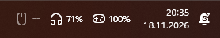
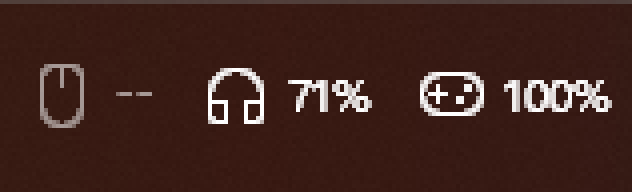

# BatteryBar

A small Windows 11 widget that shows the battery level of your wireless mouse, headset and gamepad on the
taskbar, right next to the clock.



- **Logitech without G HUB.** Logitech devices are read directly over HID++ 2.0. G HUB does not need to be
  running (it can be, both work side by side).
- **Flydigi VADER 5 Pro** on its 2.4G receiver, which Windows otherwise only reports as "wired".
- **Read-only.** BatteryBar only sends status queries to the devices; it never changes a device setting.
- **Game friendly.** No driver, no administrator rights, no code injected into other programs. The widget
  never takes focus and hides while a full-screen game or video is in front (see
  [Games and anti-cheat](#games-and-anti-cheat)).
- Hover for the full device names and states. Right-click for **Refresh**, **Start with Windows** and
  **Exit**.
- Below 20 % the value turns red, a small bolt shows charging, and a sleeping or switched-off device shows
  `--` (dimmed). When a battery drops below 15 % Windows shows one notification per device (re-armed once it
  charges or goes above 20 %).
- One widget per taskbar, so it also appears on the taskbars of other monitors. Light and dark theme follow
  Windows; sharp at every DPI.
- English and Turkish UI (follows the Windows display language).
- No telemetry and no network access at all.



## Supported devices

Tested:

| Device | Connection | How |
|---|---|---|
| Logitech PRO X SUPERLIGHT 2 DEX | LIGHTSPEED receiver | HID++ `0x1004 UNIFIED_BATTERY` (percentage) |
| Logitech PRO X Wireless headset | its USB dongle | HID++ `0x1F20 ADC_MEASUREMENT` (voltage) |
| Flydigi VADER 5 Pro | 2.4G receiver | vendor heartbeat query, level 0-5 |

Other Logitech HID++ 2.0 devices that report their battery through `0x1004`, `0x1000 BATTERY_STATUS`,
`0x1001 BATTERY_VOLTAGE` or `0x1F20` on a LIGHTSPEED / Unifying receiver or their own dongle should work, but
were not tested. Devices are sorted into mouse, headset and gamepad from the HID++ device type and name;
anything else gets its own cell.

## Install and run

Requirements: Windows 11, 64-bit (x64). No administrator rights.

1. Download `BatteryBar-<version>-win-x64.exe` from the [Releases](../../releases) page. It is a single,
   self-contained file; no .NET install is needed. Each release also has a `.sha256` file to verify the
   download.
2. Run it. There is no installer and no window: the widget appears on the taskbar. Right-click it to exit.

**SmartScreen warning:** the exe is not code-signed, so Windows SmartScreen may show "Windows protected your
PC" on first start. Click **More info**, then **Run anyway**. If you prefer, build it yourself (see below).

- Only one copy runs at a time.
- **Start with Windows** writes `HKCU\Software\Microsoft\Windows\CurrentVersion\Run\BatteryBar` only when you
  tick it, and removes the value when you untick it.
- Log: `%LOCALAPPDATA%\BatteryBar\batterybar.log` (rotated to `.old` above 1 MB). It stays on your PC.
- `--lang en` / `--lang tr` forces the UI language for that run.
- To remove the app: untick **Start with Windows**, exit, delete the exe and `%LOCALAPPDATA%\BatteryBar`.

## Games and anti-cheat

BatteryBar is an ordinary user-mode program and is built so that it does not get in the way of games:

- **No injection, no hooks into other processes.** It loads no DLL into other programs, reads no other
  process's memory and installs no keyboard or mouse hook. The only system notification it listens to is the
  "foreground window changed" WinEvent, received out of context in its own process.
- **No driver**, no service, no administrator rights. HID devices are opened through the normal Windows API
  in shared mode, the same way G HUB or a game would.
- **Never takes focus.** The widget is a `WS_EX_NOACTIVATE` tool window; clicking it does not pull a game out
  of focus.
- **Hidden in full screen.** When a full-screen app is in front on a monitor (game, video, presentation),
  the widget on that monitor hides and does not draw over it.

No software can promise that every anti-cheat system will always accept it, but there is nothing in
BatteryBar that such systems normally look for.

## How it works

### Logitech (HID++)

1. HID collections of VID `046D` with a vendor usage page (`>= 0xFF00`) and 7 / 20 / 64-byte reports are
   HID++ collections; the collections of one USB interface are opened together as one channel, in shared
   mode.
2. If index `0xFF` answers a ping, the device is directly connected (for example the PRO X Wireless dongle).
   Otherwise it is a receiver (LIGHTSPEED / Unifying) and slots 1-6 are asked one by one.
3. Name and type come from feature `0x0005 DEVICE_NAME`. For a sleeping device the receiver's read-only
   pairing register (`0x2B5`) gives the name, so a mouse that is off at start-up still gets its cell.
4. The battery is read with the first available feature: `0x1004 UNIFIED_BATTERY`, `0x1000 BATTERY_STATUS`,
   `0x1001 BATTERY_VOLTAGE`, `0x1F20 ADC_MEASUREMENT`.
5. For voltage-only devices the percentage needs a discharge curve. If G HUB is installed, its per-device
   power model is read at run time from your own installation (`%ProgramData%\LGHUB\depots`, read only), so
   the value matches G HUB. Otherwise a generic Li-ion curve is used (the same points as HeadsetControl's
   default Logitech estimate). No G HUB file is part of this repository or the release.

Requests use their own software id (`0x0B`), so answers meant for G HUB and device notifications are ignored.
Only read queries are sent. The protocol is publicly documented by the open-source projects
[Solaar](https://github.com/pwr-Solaar/Solaar) and [HeadsetControl](https://github.com/Sapd/HeadsetControl).

### Flydigi VADER 5 Pro

XInput reports the pad as "wired", so the battery is read from the receiver's vendor HID interface
(VID `37D7`, usage page `FFA0`). BatteryBar writes one read-only heartbeat (status) query and decodes the
answer: battery level 0-5 and a charging / full flag. The level is shown as 20 % steps and as "level n/5" in
the tooltip. Flydigi Space Station does not need to be installed or running; if it is, both keep working.
Details: [docs/flydigi-protocol.md](docs/flydigi-protocol.md). The same protocol is implemented in
[SDL](https://github.com/libsdl-org/SDL)'s Flydigi driver.

### Widget

- A layered (per-pixel alpha), topmost tool window per taskbar: the primary taskbar and every secondary one.
  It is not embedded into Explorer (`SetParent` is not used).
- Placed left of the notification area. On secondary taskbars the clock is XAML, not a window, so its left
  edge is read with UI Automation every 30 s in the background.
- Re-laid out on foreground changes, Explorer restarts (`TaskbarCreated`), monitor, display and DPI changes.
- PerMonitorV2 DPI; text is drawn with GDI grayscale antialiasing (ClearType does not work on layered
  windows) in Segoe UI Variable, icons in Segoe Fluent Icons.
- Devices are polled every 60 s in the background (and at once on **Refresh** or after resume from sleep).

## Known limitations

- **Flydigi in F310 mode:** the receiver sometimes enumerates as a Logitech F310 (`046D:C21D`, XInput only).
  That mode has no vendor interface, so the battery cannot be read and the gamepad cell stays `--`.
- **Only horizontal taskbars at the bottom of the screen** are supported. With an auto-hiding taskbar the
  widget hides while the taskbar is hidden.
- **Bluetooth was not tested**, for Logitech or Flydigi; only the receivers and dongles listed above.
- Flydigi: only the VADER 5 Pro is decoded; other models show "unknown". The charging and full states were
  not seen on real hardware yet.
- Voltage-based percentages (headset) read a little high while charging, and without G HUB installed the
  generic curve can differ from G HUB's value by several points.
- Values update at most once a minute; a device that wakes up shows its value at the next poll (or
  **Refresh**).

## Build from source

Requirements: Windows, [.NET 8 SDK](https://dotnet.microsoft.com/download/dotnet/8.0).

```
dotnet build BatteryBar.sln -c Release
dotnet test BatteryBar.sln
dotnet run --project src/BatteryBar
```

Single-file, self-contained exe (as on the Releases page):

```
dotnet publish src/BatteryBar/BatteryBar.csproj -c Release -r win-x64 --self-contained -p:PublishSingleFile=true -o publish
```

Without `--self-contained` the exe is small but needs the
[.NET 8 Desktop Runtime](https://dotnet.microsoft.com/download/dotnet/8.0).

Diagnostics (console): `dotnet run --project src/BatteryBar.Probe -- --deep --raw` lists all Logitech HID
collections, HID++ feature indexes and the raw requests and answers, then what every provider reads.

Repository layout:

```
src/BatteryBar.Core     providers, HID / HID++ layer, Flydigi decoder, widget model, UI strings (no UI)
src/BatteryBar          WinForms shell: one layered overlay window per taskbar
src/BatteryBar.Probe    console diagnostics tool
tests/BatteryBar.Tests  xUnit tests
docs/                   Flydigi protocol notes, screenshots
```

The app uses no NuGet packages; all Windows APIs are called through P/Invoke.

Pushing a tag such as `v1.0.0` runs `.github/workflows/release.yml`, which runs the tests, builds the exe and
attaches it to a GitHub release.

### Adding a provider

Implement `IBatteryProvider` (`src/BatteryBar.Core`) and add it to `BatteryProviders.CreateDefault()`:

```csharp
public interface IBatteryProvider : IDisposable
{
    string Name { get; }
    IReadOnlyList<DeviceBattery> Poll(CancellationToken cancellationToken);
}
```

- `Poll()` runs on a background thread and must never throw; return `DeviceBattery.Disconnected(...)` for a
  device that is off or asleep, and an empty list when its receiver is not plugged in.
- `DeviceBattery` carries an id, name, kind (mouse / headset / gamepad / other), percentage (null =
  unknown), charging and connected flags.
- Devices with coarse levels can set `Detail` (a tooltip note) and `AlertAtOrBelow` (their own low-battery
  threshold).
- Only send read-only queries, open devices in shared mode, and keep the parsing in a pure function with
  tests, as the existing providers do.

## Disclaimer

BatteryBar is an independent project. It is not affiliated with, endorsed by or supported by Logitech or
Flydigi. Logitech, G HUB, LIGHTSPEED, Unifying and PRO X are trademarks of Logitech; Flydigi, VADER and Space
Station are trademarks of Flydigi. All other trademarks belong to their owners. Device protocols are
described only as far as needed for interoperability.

## License

[MIT](LICENSE). Copyright (c) 2026 Zeruh31.

---

## Türkçe

Kablosuz fare, kulaklık ve oyun kolunun pil seviyesini görev çubuğunda, saatin hemen solunda gösteren küçük
bir Windows 11 aracı.

- Logitech cihazları G HUB olmadan, doğrudan HID++ 2.0 ile okunur; G HUB açıkken de çalışır.
- Flydigi VADER 5 Pro, 2.4G alıcısı üzerinden okunur (Windows onu yalnız "kablolu" gösterir).
- Yalnız durum sorguları gönderilir; cihaz ayarı değiştirilmez.
- Sürücü yok, yönetici yetkisi yok, başka programlara kod enjekte edilmez. Widget odak çalmaz ve tam ekran bir
  oyun ya da video öndeyken o monitörde gizlenir.
- Fareyle üzerine gelince tam cihaz adları görünür. Sağ tık: **Yenile**, **Windows ile başlat**, **Çıkış**.
- %20 altı kırmızı, şarjda küçük şimşek, uyuyan cihaz `--`. Pil %15'in altına inince cihaz başına bir
  bildirim gelir.
- Arayüz Windows dili Türkçeyse Türkçe, değilse İngilizcedir (`--lang tr` / `--lang en` ile seçilebilir).
- Telemetri ve ağ erişimi yoktur.

Kurulum: [Releases](../../releases) sayfasından `BatteryBar-<sürüm>-win-x64.exe` dosyasını indirip
çalıştırın; .NET kurmak gerekmez. Exe imzasız olduğu için SmartScreen uyarısında **Ek bilgi > Yine de
çalıştır** deyin.

Bilinen sınırlar: Flydigi alıcısı F310 modunda görünürse kol pili okunamaz; yalnız ekranın altındaki yatay
görev çubuğu desteklenir; Bluetooth test edilmedi.

Bu proje Logitech ya da Flydigi ile bağlantılı değildir; markalar sahiplerine aittir.
